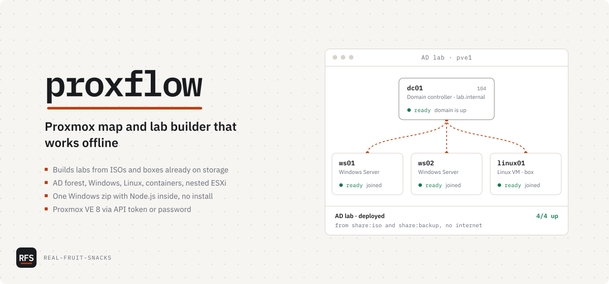

# proxflow

Proxmox map and lab builder that works offline

<picture>
  <source media="(prefers-color-scheme: dark)" srcset="docs/assets/cover-dark.svg">
  
</picture>

```powershell
[Net.ServicePointManager]::SecurityProtocol = 'Tls12'; $ProgressPreference = 'SilentlyContinue'; irm https://github.com/Real-Fruit-Snacks/proxflow/releases/latest/download/proxflow-windows-x64.zip -OutFile proxflow.zip; Expand-Archive proxflow.zip .
```

Or download `proxflow-windows-x64.zip` from [Releases](https://github.com/Real-Fruit-Snacks/proxflow/releases/latest), unblock it (Properties, Unblock) and extract it. Double-click `ProxFlow.cmd`; your browser opens ProxFlow. Node.js is inside the zip, so there is nothing to install and no admin rights are needed. `ProxFlow-demo.cmd` starts it against a simulated Proxmox.

The Proxmox I build labs on has no internet. ISOs sit on one share and community-built boxes on another, and every machine meant restoring a box, cloning it and setting its name, address and domain by hand. ProxFlow maps the cluster and does that routine, and the setup inside each machine, from one canvas. It assumes Proxmox VE 8 and an API token (or a username and password). More on the [project page](https://real-fruit-snacks.github.io/proxflow/).

## What's in it

| Part | Does |
|---|---|
| Map | Shows every node, VM, container, bridge and storage, with live CPU and memory, power actions and snapshots |
| Connections | Adds a host by API token or password; Test names certificate, login, network and permission problems |
| Build | Designs a lab on a canvas, reviews the plan, deploys it, destroys it |
| Lab machines | Domain controller and Windows Server (ISO or box), Linux VM (box, template or disk image), container, nested ESXi |
| Demo mode | Runs a simulated Proxmox with ISOs, boxes and templates |
| The zip | Holds Node.js 24, the server and the web UI; nothing is installed or fetched at run time |

## Tested on

- Windows 11 Pro · the release zip with its bundled Node.js 24.22.2
- GitHub Actions `windows-latest` on every release · a fresh extract with no Node.js on PATH, a 10-machine lab, a read-only install folder
- The simulated Proxmox VE 8.4 API in demo mode · an AD forest, Windows and Linux boxes with and without the guest agent, containers, nested ESXi, 37 connection checks
- *Not* tested: a real Proxmox host. Everything above ran against the simulated API.

## Known issues

- Reading the config inside backups, importing disk images (Proxmox 8.3+) and the guest-agent permission names on Proxmox 9 follow the documentation and have not met real hardware yet.
- Nested ESXi types its boot option at the installer menu. If that is missed, press Shift+O in the console and add `ks=cdrom:/KS.CFG`.
- The Windows edition list assumes Microsoft's usual image order inside the ISO.
- A Linux box joins the domain only if `realmd`, `sssd` and `adcli` are already in the image.
- ProxFlow has no login of its own. Start it with `--host 127.0.0.1` on a shared network.

## Configuration

Options for `ProxFlow.cmd`:

| Setting | Does |
|---|---|
| `--port 8080` | Serves on another port (default 3001, or the next free one) |
| `--host 127.0.0.1` | Lets only this computer open ProxFlow |
| `--data-dir <path>` | Keeps connections and lab history somewhere else (default: `data` next to `ProxFlow.cmd`) |
| `--demo` | Uses the simulated Proxmox |
| `--no-open` | Doesn't open a browser |
| `PVE_URL` | Adds a host from the environment, with `PVE_TOKEN_ID` and `PVE_TOKEN_SECRET`; `PVE_FINGERPRINT` pins its certificate |

Proxmox roles for the API token: `PVEAuditor` on `/` for the map. To build labs, add `PVEVMAdmin` on `/`, `PVEDatastoreAdmin` on `/storage` and, on Proxmox 8 or later, `PVESDNUser` on `/sdn/zones/localnetwork`.

Building from source and releasing: [docs/DEVELOPMENT.md](docs/DEVELOPMENT.md).

## License

MIT
